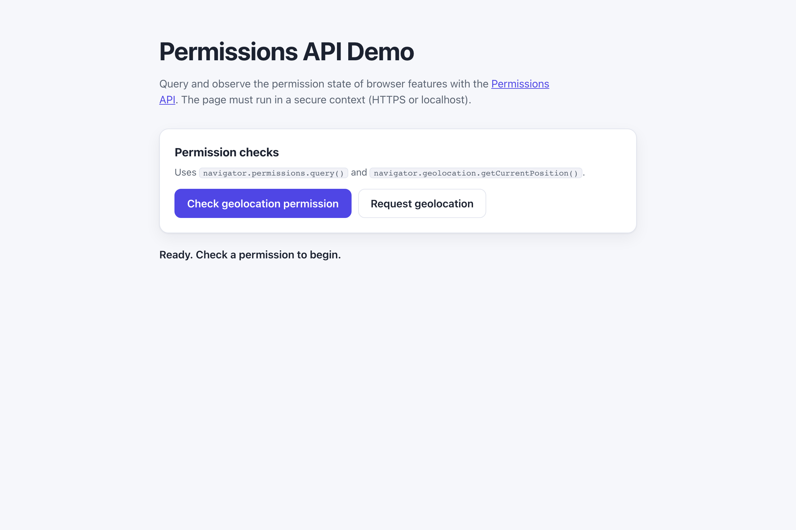

# WebSharper.Permissions

[](https://github.com/dotnet-websharper/Permissions)

WebSharper bindings for the [Permissions API](https://developer.mozilla.org/en-US/docs/Web/API/Permissions_API) —
querying and observing the permission state of browser features such as geolocation, notifications, and the microphone.

The Permissions API is only available in [secure contexts](https://developer.mozilla.org/en-US/docs/Web/Security/Defenses/Secure_Contexts)
(HTTPS or localhost), and some browsers only expose it for a subset of features.

This repository contains:

| Project | Purpose |
| --- | --- |
| `WebSharper.Permissions` | The binding: WIG definitions for `Permissions`, `PermissionStatus`, `PermissionState`, and `PermissionDescriptor`. |
| `WebSharper.Permissions.Extensions` | `[<Inline>]` client extensions: `navigator.permissions` on `Navigator` and `WorkerNavigator`. |
| `WebSharper.Permissions.Sample` | An ASP.NET Core SPA that queries the geolocation permission and requests a geolocation position. |

## Live demos

**Try it live:** [Open the sample in your browser](https://dotnet-websharper.github.io/Permissions/)



The sample doubles as the binding's [test case](#running-the-sample): it queries a permission state and requests a geolocation position in a real browser.

- **Sample (this repository):** <https://dotnet-websharper.github.io/Permissions/>
- **Source repository:** <https://github.com/dotnet-websharper/Permissions>
- **WebSharper bindings:** <https://websharper.com/bindings>

## Features

- `Permissions` (`query`) and `PermissionStatus` (`name`, `state`, `onchange`).
- `PermissionState` as a string enum (`granted`, `denied`, `prompt`).
- `PermissionDescriptor` with optional `userVisibleOnly` and `sysex` fields.
- `navigator.permissions` on `Navigator` and `WorkerNavigator` in the Extensions assembly.

## Installation

The binding is not currently published to NuGet. Reference the projects from source:

```bash
git clone https://github.com/dotnet-websharper/Permissions.git
```

```xml
<ItemGroup>
  <ProjectReference Include="path/to/WebSharper.Permissions/WebSharper.Permissions.fsproj" />
  <ProjectReference Include="path/to/WebSharper.Permissions.Extensions/WebSharper.Permissions.Extensions.fsproj" />
</ItemGroup>
```

## Usage

```fsharp
namespace WebSharper.Permissions.Demo

open WebSharper
open WebSharper.JavaScript
open WebSharper.Permissions

[<JavaScript>]
module Demo =
    let checkGeolocationPermission () =
        let permissions = JS.Window.Navigator.Permissions
        permissions.Query(PermissionDescriptor(name = "geolocation"))
            .Then(fun status -> Console.Log($"geolocation: {status.State}"))
            .Catch(fun _ -> Console.Log("Permissions API not supported"))
```

The `navigator.permissions` accessor is declared in the Extensions assembly and hangs off `JS.Window.Navigator`.
`query()` returns a `Promise<PermissionStatus>`; `PermissionStatus.state` is a `PermissionState` string enum.

## Running the sample

Build the sample in Release and serve its static output:

```bash
dotnet build WebSharper.Permissions.Sample/WebSharper.Permissions.Sample.fsproj -c Release
python3 -m http.server -d WebSharper.Permissions.Sample/wwwroot 8201
```

Open <http://localhost:8201/>. Localhost counts as a secure context, so the Permissions API is available.

Alternatively, run the ASP.NET Core host:

```bash
dotnet run --project WebSharper.Permissions.Sample
```

## Building from source

### Prerequisites

- [.NET SDK 10](https://dotnet.microsoft.com/download) or later.

### Build

```bash
dotnet build WebSharper.Permissions.sln -c Release
```

The binding projects target `netstandard2.0`; the sample targets `net10.0`.

## Deployment

Pushing to `main` triggers `.github/workflows/ghpages.yml`, which builds the sample in Release and publishes
`WebSharper.Permissions.Sample/wwwroot` to the `gh-pages` branch.

## Repository layout

```
WebSharper.Permissions/              # binding (WIG definitions)
  Main.fs
WebSharper.Permissions.Extensions/   # [<Inline>] client extensions
  Library.fs
WebSharper.Permissions.Sample/       # ASP.NET Core SPA demo
  Client.fs
  Startup.fs
  wwwroot/
    index.html
    site.css
.github/workflows/ghpages.yml        # build + deploy the sample to GitHub Pages
```

## Notes on the API

- **Secure context:** the Permissions API is only exposed in secure contexts. Serve the page over HTTPS or from
  localhost.
- **Feature support:** `navigator.permissions.query()` only accepts a subset of permission names, and browsers
  differ in which ones they support. Querying an unsupported name rejects the promise; handle the rejection.
- **User gesture:** geolocation and notification permission prompts require a user gesture (for example, a button
  click).
- **Change events:** `PermissionStatus.onchange` fires when the permission state changes. Use it to keep the UI
  in sync.

## License

Apache 2.0 — see [LICENSE.md](LICENSE.md).
